

# Kubo

### Manage your Linux server from a window, not just a terminal.

Kubo is a free desktop app for **Windows and Linux**. It connects to **your own Linux server** over SSH
and shows you what is going on: files, open ports, firewall, websites, services, Docker, Redis, packages.

**Nothing is installed on your server. Nothing is sent anywhere else.**

[**⬇ Download for Windows**](https://github.com/Lightminedust/Kubo/releases/latest) &nbsp;·&nbsp;
[**⬇ Download for Linux**](https://github.com/Lightminedust/Kubo/releases/latest) &nbsp;·&nbsp;
[Website](https://kubo.gemmi-e.com) &nbsp;·&nbsp; Java included &nbsp;·&nbsp; ~75 MB

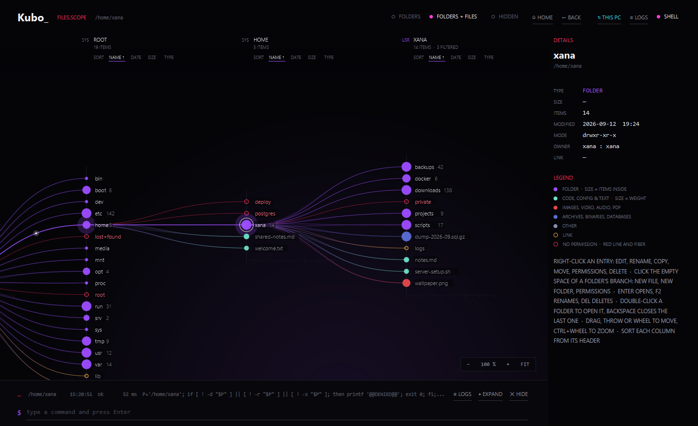

---

## Who it's for

You rented a VPS, set up a Raspberry Pi, or run a small server for a website, a bot or a game. You can use
the terminal, but you don't want to remember twenty commands just to answer simple questions:

- Which ports are open, and which ones can the internet actually reach?
- Why isn't my website answering?
- Who keeps trying to get into my server?
- Which services will **not** come back after a reboot?

Kubo answers those questions on screen. It does not replace your terminal: it works next to it.

## How it works

- **Over SSH, nothing else.** Kubo runs ordinary Linux commands, the same ones you would type. There is no
  agent, no service and no web page added to your server, and nothing is left behind when you close it.
- **You see every command.** Everything Kubo sends is listed as it happens and saved in a log on your
  computer. The log keeps the commands, never their output or your files.
- **Read-only until you ask.** Looking never changes anything. When you do make a change, Kubo shows it
  first or asks you to confirm.
- **Private.** No account, no tracking, no cloud. Kubo only talks to your server.

---

## What you can do

### Files

Browse your server's folders as a tree. Right-click to edit, rename, copy, move, change permissions,
download or delete. Drag a file from your PC onto a folder to upload it.

### Network: what is really exposed

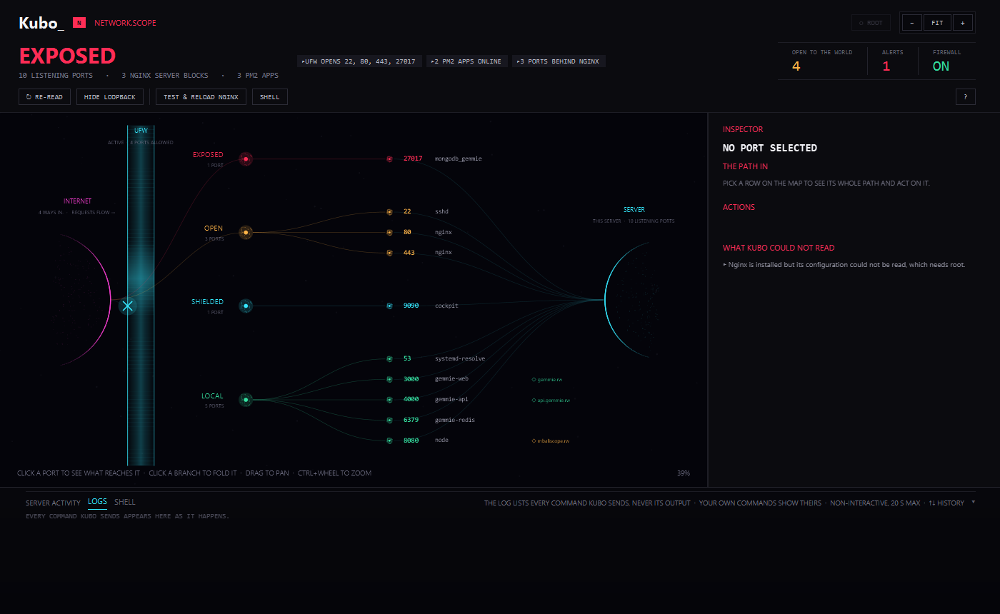

See every open port and how far it can be reached: **open to the internet**, **blocked by the firewall**,
or **only reachable from the server itself**. A database open to the whole internet stands out immediately.

Works with **UFW, firewalld, nftables and iptables**. With UFW you can also open or close ports, allow
one address only, and switch the firewall on or off. Kubo stops you before a change that would cut off
your own SSH connection.

### Websites (Nginx)

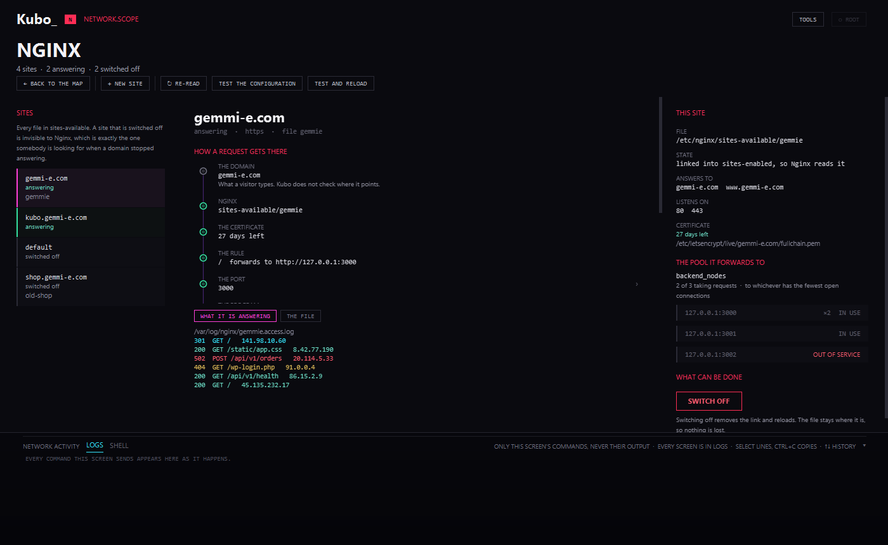

For each website, Kubo shows the path a visitor's request takes: domain → Nginx site → certificate →
rule → the program or folder that answers. The step that is broken turns red. You also see the site's
logs and its configuration file.

You can **create a new site** from a form, with presets for a Node app, a single-page app, a static site
or PHP. You see the exact file before it is written, and Nginx checks it before anything is switched on.

Using Caddy, Apache, Traefik or HAProxy instead? Kubo tells you what it found and where its
configuration is.

### Blocked addresses (fail2ban and firewall)

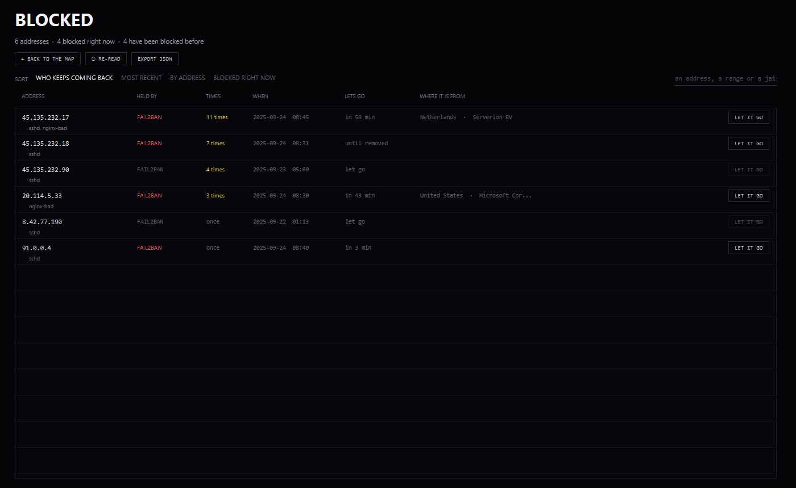

The list of addresses your server has banned, one row each: how many times, when, how long the ban
lasts, and who owns the address. The ones that **keep coming back** are at the top, because those are
the ones actually trying to get in. Firewall rules are in the same list. Export it as JSON if you want.

### Services (systemd)

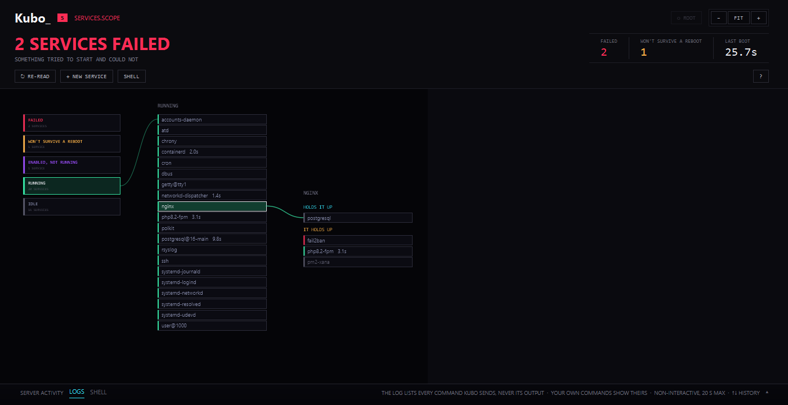

Every service, sorted by what matters:

**failed** · **running now but won't start after a reboot** · **enabled but stopped** · **running** · **idle**

Start, stop, restart, enable or disable a service. Limit its memory or CPU without restarting it. Add
your own settings without touching the original file, or create a new service.

For your safety, Kubo **refuses** to stop or disable SSH, or the network under it: that is the one
mistake that would lock you out of your own server for good.

### And also

| | |
|---|---|
| 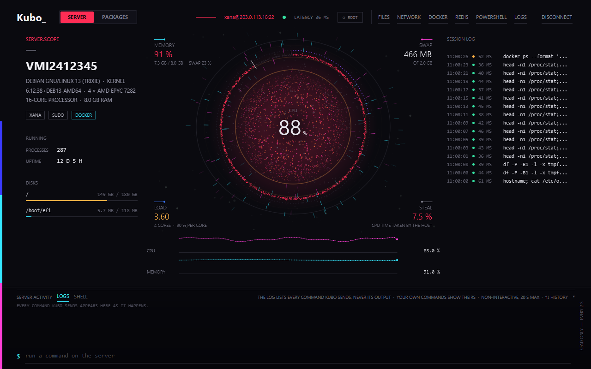 | **System**: operating system, CPU, memory, swap and load, live. |
| 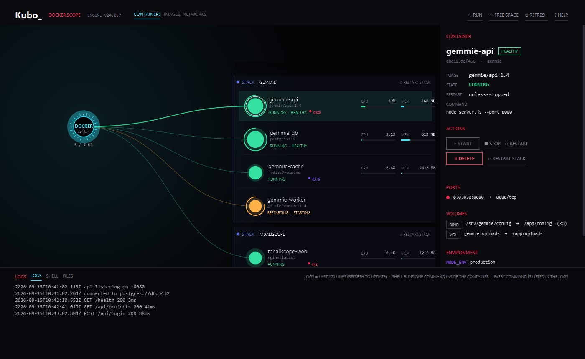 | **Docker**: your containers, their state, CPU, memory, ports and volumes. Start, stop, restart, read the logs, open a shell inside. |
| 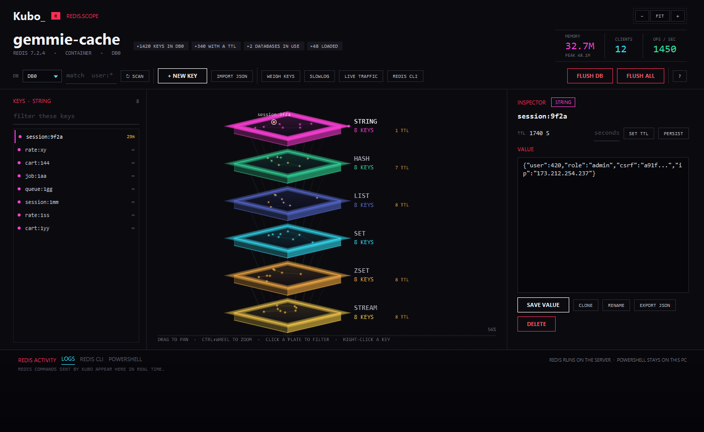 | **Redis**: browse, edit and delete keys, see memory use and slow commands, use a live console. Never runs `KEYS *`, which can freeze a busy server. |
| 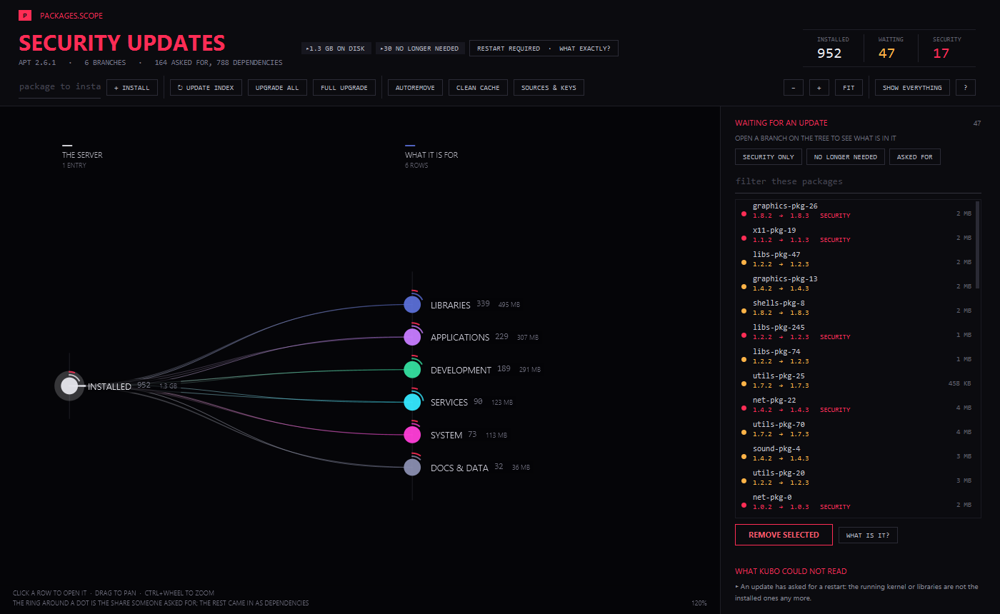 | **Packages** (Debian, Ubuntu): what is installed, what you installed yourself, what can be updated. Updates are simulated first, and Kubo tells you what a removal would also remove. |
| 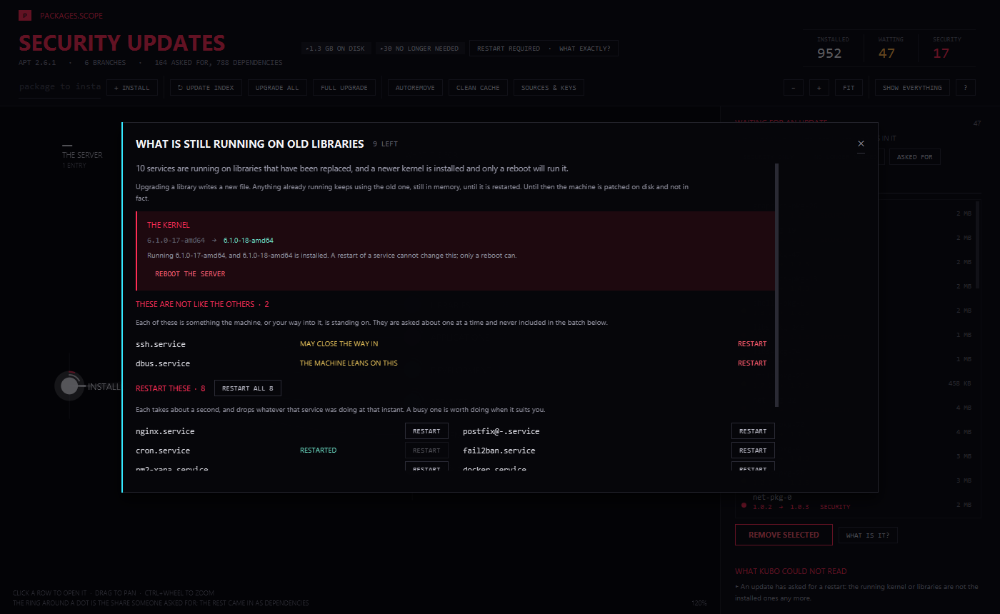 | **Restart after updates**: after an update, programs already running keep the old version until they restart. Kubo lists them, so a "fully updated" server isn't still running the old, vulnerable code. |

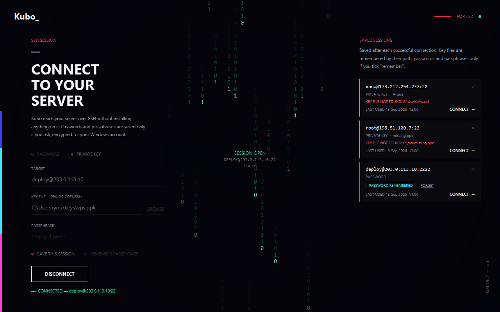

---

## Security

Kubo needs SSH access, and sometimes root. Here is how it handles that:

- **Server identity is checked.** On first connection Kubo shows the server's fingerprint and asks you.
  If it changes later, Kubo refuses to connect.
- **Passwords are not kept around.** They stay in memory only as long as needed, then are erased. They
  are saved only if you tick *Remember*, encrypted for your Windows account. On Linux, Kubo never saves
  passwords.
- **Root only when you click for it.** Kubo never switches to root on its own. One button asks for sudo
  once per session, and the window title shows `Kubo_root` while it is on.
- **No surprises.** Risky changes are simulated or need you to type the name to confirm. Commands that
  run as root are fixed in advance, never built from what you type.

---

## Install

**Windows**: download **[Kubo Setup](https://github.com/Lightminedust/Kubo/releases/latest)** and run it.
The installer isn't code-signed yet, so Windows may say *"unknown publisher"*: click **More info → Run
anyway**. Then open Kubo from the Start menu.

**Linux**: a `.deb` (Debian, Ubuntu) and an `.rpm` (Fedora, RHEL, Rocky, Alma, openSUSE) are on the
[releases page](https://github.com/Lightminedust/Kubo/releases/latest).

**Portable**: a `.zip` (Windows) and a `.tar.gz` (Linux). Unzip anywhere and run, no installation and no
admin rights needed.

Then type your server's address (`user@host`) and connect.

### What your server needs

Any normal Linux server: Debian, Ubuntu, Raspberry Pi OS, RHEL, Rocky, Alma, Fedora, Arch, openSUSE…
The **Packages** screen needs a Debian-based system (apt). Everything else works everywhere.

---

## About

Kubo is made by **Gemmie** and is free to use. It is not open source: the code is not published, but Kubo
collects nothing and contacts no one other than your server. See the [license](LICENSE.txt).

**How it was made.** Kubo is designed and built by one developer who manages Linux servers. AI tools were
used to help with the visual style and with some of the more complex Linux commands.

Questions, bugs or ideas: [gemmi-e.com/contact](https://gemmi-e.com/contact).

*If Kubo is useful to you, a ⭐ on this repository helps other people find it.*
